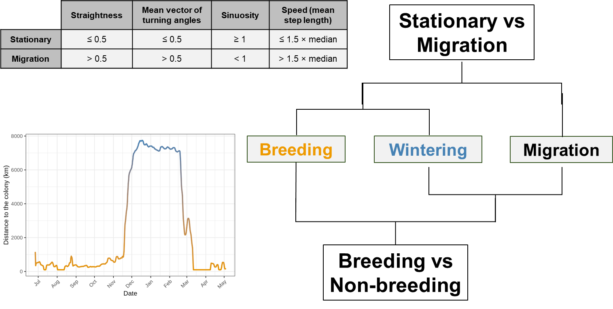

# Classification rules of AutoPhen_GLS

This document describes, step by step, how AutoPhen_GLS classifies a track into
breeding (B), migration (mig) and wintering (W) stages, and how the
phenological dates are obtained. It describes the code in `functions/` and
the values in `parameters.R`. Parameter names are written as `adv$name`
(advanced parameters) or `name` (user parameters).

All distances are in km. Before any calculation, positions are projected to
an azimuthal equidistant projection centred on the colony, so the colony is at
(0, 0) and the net squared colony distance (NSCD) of a position is
x² + y² (km²).

---

## Overview

| Step | What is done |
|---|---|
| 1. Preparation of the track (01) | Projection, removal of outliers and repeated positions |
| 2. Segmentation (01) | Segmentation of the track with `segclust2d` |
| 3. Movement metrics (01) | Movement metrics of each segment |
| 4. Clustering of segments (01) | Two clusterings of the segments: movement mode and distance to the colony |
| 5. Initial classification (01) | Initial class (B, mig or W) of each segment |
| 6. Agreement score and selection of metrics (01) | Agreement between class and movement; selection of the best combination of metrics |
| 7. Corrections (01) | Corrections for the equinoxes, distance, speed and impossible sequences |
| 8. Segments to review (01) | Agreement of the final classes and segments flagged for review |
| 9. Supervised correction (02) | Optional: review and correction of the classes, position by position |
| 10. Phenological stages and breeding/wintering areas (03) | Stages of the annual cycle and kernel density estimation (KDE) of each breeding and wintering area |
| 11. Phenological dates and dates to review (03) | Arrival and departure dates, and dates flagged for review |

Steps 1-8 are done by `classify_track()` (script 01), step 9 by script 02 and
steps 10-11 by `phenology_track()` (script 03).

---

## 1. Preparation of the track

| Sub-step | Rule | Parameter |
|---|---|---|
| 1.1. Projection | Positions are projected to an azimuthal equidistant projection centred on the colony (km). | — |
| 1.2. Outliers | Positions whose distance to the next position is longer than `max_step` are removed. This is repeated until no step is longer than `max_step`. | `adv$max_step` = 4440 km |
| 1.3. Equinox windows | GLS only. Positions within `eq_window_days` of the September and March equinoxes (21 September and 21 March after the start of the track) are labelled `Sep` or `Mar`. If all positions in a window have the same latitude (latitude not estimated), only the first and last positions of the window are kept. | `eq_window_days` = 20 |
| 1.4. Repeated latitudes | If more than `max_repeated` positions have exactly the same latitude, the repeated ones are removed. | `adv$max_repeated` = 4 |
| 1.5. Repeated positions at the ends | If there are repeated latitudes among the first or last `edge_positions` positions, these positions are removed. | `adv$edge_positions` = 5 |

When the first and last positions of a track are fixed at the colony
(deployment and recovery of the logger), they are never removed in sub-steps
1.4 and 1.5.

---

## 2. Segmentation

The track is segmented with `segclust2d::segclust()` on the projected
coordinates (x, y), with:

- maximum number of segments `Kmax` = 15;
- minimum segment length `lmin` = `max(5, min_segment_days × positions_per_day)`
  = 5 positions (2.5 days with two positions per day; 5 is the minimum
  accepted by `segclust2d`);
- number of clusters `ncluster` = 5 to 10.

The number of segments and clusters is selected by BIC. Segmentation and
clustering are done together: clustering allows segments that are separated
in time but have a similar movement (e.g. the outward and return migrations)
to belong to the same cluster. The clusters themselves are not used in the
next steps; only the segments are used.

---

## 3. Movement metrics

For each segment the following metrics are calculated. Metrics from `trajr`
are calculated on the trajectory of the segment rediscretised to its mean
step length (`trajr::TrajRediscretize()`). Step length, increments and NSCD of
each position are calculated with `adehabitatLT`, and their mean and SD in
each segment are given by `segclust2d`.

| Metric | Name in the code | Package | Description | Reference |
|---|---|---|---|---|
| Straightness | `straightness` | `trajr` | Straightness index D/L: net displacement divided by path length (0-1; 1 = straight line). | Batschelet (1981) |
| Mean vector of turning angles | `ang_vector` | `trajr` | Length of the mean vector of the turning angles (0-1). High values: the bird keeps the same direction. Low values: frequent changes of direction, as when positions are concentrated in a small area. | Batschelet (1981) |
| Sinuosity | `sinuosity` | `trajr` | Sinuosity index, multiplied by the square root of the mean step length so that it has no units. Sinuosity > 1 when the mean cosine of the turning angles is < 0.6. | Benhamou (2004) |
| Maximum expected displacement | `Emax` | `trajr` | Maximum expected displacement, as a function of the number of steps. | Cheung et al. (2007) |
| Expected square displacement | `sq_disp` | `trajr` | Expected square displacement of a correlated random walk. | Kareiva & Shigesada (1983) |
| Directional change | `dc_mean`, `dc_sd` | `trajr` | Mean and SD of the change in direction over time. | Kitamura & Imafuku (2015) |
| Step length | `mu.dist`, `sd.dist` | `adehabitatLT`, `segclust2d` | Mean and SD of the step length (km between consecutive positions). `mu.dist` is a measure of speed. | Calenge et al. (2009) |
| Net squared colony distance (NSCD) | `R2n_mean`, `R2n_sd` | `adehabitatLT` | Mean and SD of the squared distance between each position and the colony. | Turchin (1998), adapted by Amélineau et al. (2021) |
| Coordinates | `mu.x`, `mu.y`, `sd.x`, `sd.y` | `adehabitatLT`, `segclust2d` | Mean and SD of the projected coordinates. | — |
| Increments in x and y | `mu.dx`, `mu.dy`, `sd.dx`, `sd.dy` | `adehabitatLT`, `segclust2d` | Mean and SD of the increments of the movement in x and y. | Calenge et al. (2009) |

If the metrics of a segment cannot be calculated (e.g. very compact segments),
they are NA and the rules below treat NA conditions as FALSE.

---

## 4. Clustering of segments

Two hierarchical clusterings (complete linkage, cut at k = 2, variables
normalised) are done on the segments of the track:

1. **Movement mode:** on the movement metrics (see step 6 for which metrics).
   The cluster that contains the segment with the lowest `ang_vector` is
   **Stationary**; the other is **Moving**.
2. **Distance to the colony:** on `R2n_mean`. The cluster that contains the
   segment with the lowest `R2n_mean` is **Near** (breeding); the other is
   **Far** (non-breeding: wintering and migration).

**Distance limit.** To decide which segments can be breeding, a distance
limit is calculated for each track, so it does not need to be fixed in
advance for each species or colony. NSCD is segmented into three segments
(Lavielle segmentation with `segclust2d`) and the limit is the mean NSCD at the
two change points between these segments.

---

## 5. Initial classification

Short segments are segments with `lmin` or `lmin + 1` positions (the shortest
segments allowed by the segmentation, about 2.5-3 days).

| Movement mode | Distance | Class |
|---|---|---|
| Stationary | Near | **B** |
| Stationary | Far | **mig** if it is a short segment and `straightness` > `adv$short_straightness` (0.5); **W** in all other cases |
| Moving | Far | **mig** |
| Moving | Near | **B** if it is the first segment of the track, or a short segment, or NSCD ≤ distance limit and `ang_vector` < `adv$breeding_ang_vector` (0.75) (the last segment of the track only needs NSCD ≤ distance limit); **mig** in all other cases |

After the corrections (step 7), each position takes the class of its segment.
Migration before the wintering stage is labelled **mig1** (post-breeding
migration) and migration after it **mig2** (pre-breeding migration).

---

## 6. Agreement score and selection of metrics

**Agreement score (0-1).** For each segment, four criteria describe the
movement expected for its class:

| Criterion | Breeding / wintering | Migration |
|---|---|---|
| `straightness` | ≤ 0.5 | > 0.5 |
| `ang_vector` | ≤ 0.5 | > 0.5 |
| `sinuosity` | ≥ 1 | < 1 |
| `mu.dist` | ≤ 1.5 × median of the track | > 1.5 × median of the track |

The agreement is the proportion of criteria that agree with the class (0,
0.25, 0.5, 0.75 or 1). It is 0 for impossible classes: breeding with NSCD above
the distance limit, wintering with NSCD below the distance limit, or migration
with `straightness` < 0.2 and `ang_vector` < 0.9. The agreement score is a
heuristic: it shows how typical the movement of a segment is for its class,
not the probability that the class is correct.

**Selection of metrics.** The movement clustering (step 4) always uses
four core metrics (`straightness`, `sinuosity`, `ang_vector`, `mu.dist`) plus
1 to 3 groups of additional metrics (`sd.dist`, `Emax`, `sq_disp`, `R2n_sd`,
`dc_mean`, `dc_sd`, `mu.x` + `mu.y`, `sd.x` + `sd.y`, `mu.dx` + `mu.dy`,
`sd.dx` + `sd.dy`): 175 combinations. Steps 4-6 are repeated for each
combination, and the classification with the highest mean agreement is kept
(if tied, the one with fewer metrics).

---

## 7. Corrections

Applied in this order to the selected classification.

**Equinox (GLS only; segments that overlap an equinox window):**

| Rule | Condition | Change |
|---|---|---|
| E1. Latitudinal noise in migration | mig, `sq_disp` < median of the track and `sd.y` > `adv$eq_sd_ratio_mig` (2) × `sd.x` (movement mostly in latitude) | → B if `R2n_mean` < mean of the track, else W |
| E2. Longitudinal movement in breeding | B, `sd.x` or `sd.y` > `adv$eq_sd_limit` (111 km) and `sd.x` > `adv$eq_sd_ratio_breed` (4) × `sd.y` (movement mostly in longitude) | → mig |

**Distance and movement:**

| Rule | Condition | Change |
|---|---|---|
| C1. Breeding far from the colony | B, `R2n_mean` > mean of the track and `straightness` < `adv$corr_straightness` (0.2) | → W |
| C2. Breeding with migratory movement | B, agreement < `adv$corr_score` (0.5), next to a migration segment, `straightness` > 0.2 and `sq_disp` > median of the track | → mig |
| C3. Wintering near the colony | W, `R2n_mean` < mean of the track | → B |
| C4. Wintering with migratory movement | W, `sq_disp` > median of the track, `sinuosity` < `adv$corr_sinuosity` (1) and `straightness` > 0.2 | → mig |
| C5. Fast wintering segments | W at the start or end of the wintering stage, `mu.dist` > `adv$fast_w_ratio` (2.75) × `mu.dist` of the main (longest) wintering segment and > `adv$fast_w_min` (250 km). Only consecutive segments from the edges of the wintering stage are changed. | → mig |

**Impossible sequences:**

| Rule | Condition | Change |
|---|---|---|
| I1. Between breeding segments | any class between two B segments | → B |
| I2. Breeding within wintering | B between two W segments | → W |
| I3. Breeding within migration | B between two mig segments (not the first or last segment) | → W |

---

## 8. Segments to review

The agreement score is calculated again for the final classes (the same way
for all segments, including corrected, first and last segments). A segment is
flagged **Check** if at least one of these reasons applies (column
`Check_reason`):

| Reason | Condition |
|---|---|
| low agreement | agreement < `adv$check_score` (0.5) |
| corrected | the class was changed in step 7 |
| equinox | GLS only: the segment overlaps an equinox window and there is a change of stage before or after it |
| direct B-W | change between breeding and wintering without migration between them |

---

## 9. Supervised correction

Optional. Script 02 shows each track on an interactive map with the class of
each position and the segments flagged for review. The user can change the
class of whole segments or of single positions. The corrected classification
is saved and used in step 10 instead of the automated one.

---

## 10. Phenological stages and breeding/wintering areas

| Sub-step | Rule | Parameter |
|---|---|---|
| 10.1. Short stages | Short sequences (< `min_stage_days`) between two equal classes take that class (e.g. B-B-mig-B-B → B). | `min_stage_days` = 2.5 days |
| 10.2. Consecutive wintering stages | Migration between two wintering stages, without breeding between them, is part of the wintering stage (W-mig-W → W). | — |
| 10.3. Numbering of stages | Stages are numbered in order: B1, mig1, W1, mig2, B2. If the track does not start with breeding, the first breeding stage is B2. | — |
| 10.4. KDE | For each breeding and wintering stage, a kernel density estimation (KDE) is calculated with the positions of that stage only (`track2KBA`). GLS: equinox positions are not used if more than `kde_min_positions` positions remain. Projection: Lambert azimuthal equal-area centred on the positions of the stage. Bandwidth: href. | `kde_level` = 90 %, `adv$kde_min_positions` = 5 |
| 10.5. Alternative KDE | If the KDE polygon cannot be obtained with `track2KBA::estSpaceUse()`, it is calculated with `adehabitatHR::kernelUD()`, increasing the grid extent (4, 8, 16, 32) until it works. | `adv$kde_fallback_grid` = 1000, `adv$kde_fallback_extent` = 4 |

---

## 11. Phenological dates and dates to review

Dates are searched only among the positions of the stage and of the
migrations next to it (positions of another breeding or wintering stage are
not used, even if they fall inside the KDE).

- **Arrival** = date of the first position inside the KDE.
- **Departure** = date of the first position outside the KDE after the last
  position inside it.

Breeding: only departure from B1 and arrival at B2. Wintering: arrival and
departure of each W stage.

The dates of a track are flagged **Check** if:

| Column | Condition |
|---|---|
| `Dates_in_equinox` | GLS only: a date falls within an equinox window (latitude, and therefore the date, is uncertain) |
| `KDE_overlap` | the KDEs of two consecutive breeding and wintering stages overlap (arrival and departure are poorly defined) |

---

## Choice of thresholds

The thresholds of the movement metrics are round values chosen after
preliminary tests with our data. Two of them have a simple interpretation:

- `straightness` and `ang_vector` range from 0 to 1, and 0.5 is the middle
  point between a tortuous and a directed movement.
- A dimensionless `sinuosity` of 1 corresponds to a mean cosine of the turning
  angles of 0.6.

These thresholds are not universal. They are given as advanced parameters in
`parameters.R`, so they can be adapted to other species or tracking systems,
and their effect on the results is evaluated in the sensitivity analysis.

---

## Known limitations

- Segments are classified as a whole. When a segment contains the end of one
  stage and the start of the next one, the change of stage is shifted by a
  few positions. Script 02 allows correction position by position.
- When the wintering area is inside or very close to the breeding area
  (residents or short-distance migrants), GLS positions cannot separate them.
  These tracks are flagged by `KDE_overlap` and need manual review.

---

## References

- Amélineau F, Merkel B, Tarroux A, Descamps S, Anker-Nilssen T, Bjørnstad O, et al. (2021). Six pelagic seabird species of the North Atlantic engage in a fly-and-forage strategy during their migratory movements. *Marine Ecology Progress Series* 676: 127-144.
- Batschelet E (1981). *Circular statistics in biology.* Academic Press.
- Benhamou S (2004). How to reliably estimate the tortuosity of an animal's path: straightness, sinuosity, or fractal dimension? *Journal of Theoretical Biology* 229: 209-220.
- Calenge C, Dray S, Royer-Carenzi M (2009). The concept of animals' trajectories from a data analysis perspective. *Ecological Informatics* 4: 34-41.
- Cheung A, Zhang S, Stricker C, Srinivasan MV (2007). Animal navigation: the difficulty of moving in a straight line. *Biological Cybernetics* 97: 47-61.
- Kareiva PM, Shigesada N (1983). Analyzing insect movement as a correlated random walk. *Oecologia* 56: 234-238.
- Kitamura T, Imafuku M (2015). Behavioural mimicry in flight path of Batesian intraspecific polymorphic butterfly *Papilio polytes*. *Proceedings of the Royal Society B* 282: 20150483.
- Turchin P (1998). *Quantitative analysis of movement: measuring and modeling population redistribution in animals and plants.* Sinauer Associates.
