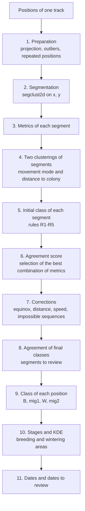

# Classification rules of AutoPhen_GLS

This document describes, step by step, how AutoPhen_GLS classifies a track into
breeding (B), migration (mig) and wintering (W) stages, and how the
phenological dates are obtained. It describes the code in `functions/` and
the values in `parameters.R`. Parameter names are written as `adv$name`
(advanced parameters) or `name` (user parameters).

All distances are in km. Before any calculation, positions are projected to
an azimuthal equidistant projection centred on the colony, so the colony is at
(0, 0) and the net squared colony distance (NSCD) of a position is
x² + y² (km²).

---

## Overview

Steps 1-9 are done by `classify_track()` (script 01). Steps 10-11 are done by
`phenology_track()` (script 03). Script 02 (optional) lets the user correct
classes position by position between steps 9 and 10.

---

## 1. Preparation of the track

| Step | Rule | Parameter |
|---|---|---|
| 1.1 | Positions are projected to an azimuthal equidistant projection centred on the colony (km). | — |
| 1.2 | Outliers: positions whose distance to the next position is longer than `max_step` are removed. This is repeated until no step is longer than `max_step`. | `adv$max_step` = 4440 km |
| 1.3 | GLS only. Equinox windows: positions within `eq_window_days` of the September and March equinoxes (21 September and 21 March after the start of the track) are labelled `Sep` or `Mar`. If all positions in a window have the same latitude (latitude not estimated), only the first and last positions of the window are kept. | `eq_window_days` = 20 |
| 1.4 | Repeated latitudes: if more than `max_repeated` positions have exactly the same latitude, the repeated ones are removed. | `adv$max_repeated` = 4 |
| 1.5 | If there are repeated latitudes among the first or last `edge_positions` positions, these positions are removed. | `adv$edge_positions` = 5 |

Positions fixed at the colony (the first and last positions of complete
tracks, see `analyses/prepare_full_dataset.R`) are never removed in steps 1.4
and 1.5.

---

## 2. Segmentation

The track is segmented with `segclust2d::segclust()` on the projected
coordinates (x, y), with:

- maximum number of segments `Kmax` = 15;
- minimum segment length `lmin` = `max(5, min_segment_days × positions_per_day)`
  = 5 positions (2.5 days with two positions per day; 5 is the minimum
  accepted by segclust2d);
- number of clusters `ncluster` = 5 to 10.

The number of segments and clusters is selected by BIC. The clusters of
segclust2d are not used later: only the segments are used.

---

## 3. Metrics of each segment

For each segment the following metrics are calculated:

| Metric | Description |
|---|---|
| `straightness` | Net displacement / path length (0-1; 1 = straight line). `trajr::TrajStraightness()` on the trajectory rediscretised to its mean step length. |
| `ang_vector` | Mean resultant length of the turning angles (0-1). High values: the bird keeps the same direction; low values: the bird turns in all directions ("a ball of positions"). |
| `sinuosity` | Sinuosity index (Benhamou 2004), made dimensionless by multiplying by the square root of the mean step length. Sinuosity > 1 when the mean cosine of the turning angles is < 0.6. |
| `mu.dist` | Mean step length (km between consecutive positions): a measure of speed. |
| `R2n_mean`, `R2n_sd` | Mean and SD of NSCD. |
| Others | `sd.dist`, `Emax`, `sq_disp` (expected square displacement), `dc_mean`, `dc_sd` (directional change), and mean and SD of x, y, dx, dy. |

If the metrics of a segment cannot be calculated (e.g. very compact segments),
they are NA and the rules below treat NA conditions as FALSE.

---

## 4. Clustering of segments

Two hierarchical clusterings (complete linkage, cut at k = 2, variables
normalised) are done on the segments of the track:

1. **Movement mode (S_M):** on the movement metrics (see step 6 for which
   metrics). The cluster that contains the segment with the lowest
   `ang_vector` is **Stationary**; the other is **Moving**.
2. **Distance to the colony (B_nB):** on `R2n_mean`. The cluster that
   contains the segment with the lowest `R2n_mean` is **Near (B)**; the other
   is **Far (Non-B)**.

A **distance limit** (NSCD limit) is also calculated: NSCD is segmented into
3 segments (`segclust2d`, `adv$nscd_Kmax` = 3, `adv$nscd_ncluster` = 3) and the
limit is the mean NSCD at the two change points.

---

## 5. Initial class of each segment

| Rule | Movement mode | Distance | Condition | Class |
|---|---|---|---|---|
| R1 | Stationary | Near | — | **B** |
| R2 | Stationary | Far | short segment (≤ `lmin` positions) and `straightness` > `adv$short_straightness` (0.5) | **mig** |
| R3 | Stationary | Far | otherwise | **W** |
| R4 | Moving | Far | — | **mig** |
| R5 | Moving | Near | short segment (≤ `lmin`), or first segment of the track, or last segment with NSCD ≤ limit, or NSCD ≤ limit and `ang_vector` < `adv$breeding_ang_vector` (0.75) | **B** |
| R5b | Moving | Near | otherwise | **mig** |

---

## 6. Agreement score and selection of the metrics

**Agreement score (0-1).** For each segment, four criteria describe the
movement expected for its class:

| Criterion | Breeding / wintering | Migration |
|---|---|---|
| straightness | < 0.5 | > 0.5 |
| ang_vector | < 0.5 | > 0.5 |
| sinuosity | > 1 | < 1 |
| mean step length | ≤ 1.5 × median of the track | > 1.5 × median of the track |

The agreement is the proportion of criteria that agree with the class (0,
0.25, 0.5, 0.75 or 1). It is 0 for impossible classes: breeding with NSCD above
the limit, wintering with NSCD below the limit, or migration with
`straightness` < 0.2 and `ang_vector` < 0.9.

The agreement score is a heuristic: it shows how typical the movement of a
segment is for its class, not the probability that the class is correct.
Against a manual (supervised) classification of 122 *Calonectris* tracks,
lower agreement is related to more misclassified segments (see the paper).

**Selection of the metrics.** The movement clustering (step 4) always uses
four core metrics (`straightness`, `sinuosity`, `ang_vector`, `mu.dist`) plus
1 to 3 groups of extra metrics (`sd.dist`, `Emax`, `sq_disp`, `R2n_sd`,
`dc_mean`, `dc_sd`, mean x-y, SD x-y, mean dx-dy, SD dx-dy): 175 combinations.
Steps 4-6 are repeated for each combination, and the classification with the
highest mean agreement is kept (if tied, the one with fewer metrics). We also
tested a consensus classification (the most frequent class of each segment
across all combinations); it agreed less with the manual classification.

---

## 7. Corrections

Applied in this order to the selected classification.

**Equinox (GLS only; segments that overlap an equinox window):**

| Rule | Condition | Change |
|---|---|---|
| E1 | mig, `sq_disp` < median of the track and SD(y) > `adv$eq_sd_ratio_mig` (2) × SD(x) (movement mostly in latitude) | → B if `R2n_mean` < mean of the track, else W |
| E2 | B, SD(x) or SD(y) > `adv$eq_sd_limit` (111 km) and SD(x) > `adv$eq_sd_ratio_breed` (4) × SD(y) (movement mostly in longitude) | → mig |

**Distance and movement:**

| Rule | Condition | Change |
|---|---|---|
| C1 | B, `R2n_mean` > mean of the track and `straightness` < `adv$corr_straightness` (0.2) | → W |
| C2 | B, agreement < `adv$corr_score` (0.5), next to a migration segment, `straightness` > 0.2 and `sq_disp` > median of the track | → mig |
| C3 | W, `R2n_mean` < mean of the track | → B |
| C4 | W, `sq_disp` > median of the track, `sinuosity` < `adv$corr_sinuosity` (1) and `straightness` > 0.2 | → mig |
| C5 | W at the start or end of the wintering stage, `mu.dist` > `adv$fast_w_ratio` (2.75) × `mu.dist` of the main (longest) wintering segment and > `adv$fast_w_min` (250 km). Only consecutive segments from the edges of the wintering stage are changed. | → mig |

**Impossible sequences:**

| Rule | Condition | Change |
|---|---|---|
| I1 | any class between two B segments | → B |
| I2 | B between two W segments | → W |
| I3 | B between two mig segments (not the first or last segment) | → W |

---

## 8. Final agreement and segments to review

The agreement score is calculated again for the final classes (the same way
for all segments, including corrected, first and last segments). A segment is
flagged **Check** if at least one of these reasons applies (column
`Check_reason`):

| Reason | Condition |
|---|---|
| low agreement | agreement < `adv$check_score` (0.5) |
| corrected | the class was changed in step 7 |
| equinox | GLS only: the segment overlaps an equinox window and there is a change of stage before or after it |
| direct B-W | change between breeding and wintering without migration between them |
| far W | wintering segment more than `adv$w_far_km` (1000 km) from the main wintering segment (possible stopover or migration loop) |

---

## 9. Class of each position

Each position gets the class of its segment. Migration before the last
wintering segment is **mig1** (post-breeding migration) and migration after
it is **mig2** (pre-breeding migration).

---

## 10. Stages and breeding/wintering areas (script 03)

| Step | Rule | Parameter |
|---|---|---|
| 10.1 | Short sequences (< `min_stage_days`) between two equal classes take that class (e.g. B-B-mig-B-B → B). | `min_stage_days` = 2.5 days |
| 10.2 | Migration between two wintering stages, without breeding between them, is part of the wintering stage (W-mig-W → W). | — |
| 10.3 | Stages are numbered in order: B1, mig1, W1, mig2, B2. If the track does not start with breeding, the first breeding stage is B2. | — |
| 10.4 | For each breeding and wintering stage, a kernel density estimation (KDE) is calculated with the positions of that stage only. GLS: equinox positions are not used if more than `kde_min_positions` positions remain. Projection: Lambert azimuthal equal-area centred on the positions of the stage. Bandwidth: href. | `kde_level` = 90 %, `adv$kde_min_positions` = 5 |
| 10.5 | If the KDE polygon cannot be obtained with `track2KBA::estSpaceUse()`, it is calculated with `adehabitatHR::kernelUD()`, increasing the grid extent (4, 8, 16, 32) until it works. | `adv$kde_fallback_grid` = 1000, `adv$kde_fallback_extent` = 4 |

---

## 11. Dates and dates to review

Dates are searched only among the positions of the stage and of the
migrations next to it (positions of another breeding or wintering stage are
not used, even if they fall inside the KDE).

- **Arrival** = date of the first position inside the KDE.
- **Departure** = date of the first position outside the KDE after the last
  position inside it.

Breeding: only departure from B1 and arrival at B2. Wintering: arrival and
departure of each W stage.

The dates of a track are flagged **Check** if:

| Column | Condition |
|---|---|
| `Dates_in_equinox` | GLS only: a date falls within an equinox window (latitude, and therefore the date, is uncertain) |
| `KDE_overlap` | the KDEs of two consecutive breeding and wintering stages overlap (arrival and departure are poorly defined) |

---

## Known limitations

- The movement clustering has two groups. In some tracks the two groups
  separate other things (e.g. the breeding period from the wintering period)
  rather than stationary from moving segments.
- Segments are classified as a whole. When a segment contains the end of one
  stage and the start of the next one, the change of stage is shifted by a
  few positions. Script 02 allows correction position by position.
- When the wintering area is inside or very close to the breeding area
  (residents or short-distance migrants), GLS positions cannot separate them.
  These tracks are flagged by `KDE_overlap` and need manual review.
